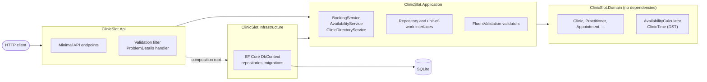

# ClinicSlot


ClinicSlot is a small appointment-booking API for clinics, built with ASP.NET Core 8 Minimal APIs and EF Core 8.
It works out free slots from practitioners' weekly hours, breaks, time off, existing bookings and buffers, all in
the clinic's own time zone (DST included). The database guarantees that two appointments can never overlap.

## Why

Booking looks like CRUD, but the hard parts are easy to get wrong:

- **Time zones.** "09:00 every Monday" means a different UTC instant before and after a DST change. A night shift
  that crosses the transition has one hour less (or more) of real time.
- **Double booking.** Checking for a free slot and then inserting is a race. Two requests can both see the slot as free.
- **Rules that depend on "now".** Cancellation cutoffs and "no bookings in the past" need a clock you can control in tests.

ClinicSlot handles each of these in a small codebase you can read in one sitting.

## Features

- Clinics with an IANA time zone, a slot interval (e.g. every 15 minutes) and a change cutoff (e.g. 24 hours)
- Services with a duration and a trailing buffer (clean-up or notes time)
- Practitioners with weekly working hours and breaks per day, plus one-off time-off blocks
- Availability for any range of up to 31 local dates
- Booking, cancellation and rescheduling. No changes within N hours of the start
- Double-booking prevention enforced by the database. Conflicts return `409 Conflict`
- Optimistic concurrency on appointments (version token)
- Patients identified minimally: name, email (natural key), optional phone
- FluentValidation, with every error returned as RFC 7807 `ProblemDetails`
- OpenAPI/Swagger, `/health` (includes a database check), structured JSON logging
- SQLite with EF Core migrations, applied at startup

## Architecture



| Project | Responsibility | Depends on |
| --- | --- | --- |
| `ClinicSlot.Domain` | Entities, invariants, the availability algorithm and time-zone resolution. Pure C#, no EF. | nothing |
| `ClinicSlot.Application` | Use cases, request/response contracts, validators, persistence ports. | Domain |
| `ClinicSlot.Infrastructure` | EF Core `DbContext`, mappings, repositories, migrations, conflict translation. | Application |
| `ClinicSlot.Api` | HTTP endpoints, validation filter, exception-to-ProblemDetails mapping, hosting. | Infrastructure |

## Availability algorithm

The algorithm lives in `AvailabilityCalculator`. It is a pure function: it takes a query and returns slots, with no I/O.
For each local date in the requested range it does four things:

1. **Working windows.** Take that weekday's working hours and cut out the breaks.
   `09:00–17:00` with lunch `12:00–13:00` gives two windows.
2. **Resolve to instants.** Convert each window's wall-clock start and end to UTC using `TimeZoneInfo`:
   - a time inside a *spring-forward gap* (e.g. 01:30 in London on 29 March) moves forward to the end of the gap;
   - a time that occurs *twice* at fall-back resolves to the earlier instant for a window start and the later
     instant for a window end, so a transition never shrinks a window.
3. **Walk candidates on the UTC line.** Start at the window start and step by the clinic's slot interval.
   Keep a candidate when:
   - `start + duration <= windowEnd` (the service fits),
   - `start >= now`,
   - `[start, start + duration)` does not overlap any time off,
   - `[start, start + duration + buffer)` does not overlap any existing appointment's
     `[start, end + its buffer)`.
4. **Present locally.** Return each slot as a `DateTimeOffset` with the clinic's offset for that instant, grouped by local date.

Stepping on the UTC line means a 60-minute appointment always lasts 60 real minutes. Wall-clock alignment survives
because real-world DST shifts are multiples of the slot interval. Every interval is half-open, so a slot can end
exactly when the next appointment starts. On London's spring-forward day, a `00:00–04:00` shift with hourly slots
offers `00:00+00:00`, `02:00+01:00` and `03:00+01:00`. On the fall-back day it offers five slots, and `01:00` appears
twice, once at `+01:00` and once at `+00:00`. Both cases are covered by tests.

Buffers only separate appointments from each other. An appointment must fit inside working time, but its trailing
buffer may run into a break or past closing time.

## Double-booking prevention

Every boundary, duration and buffer sits on a fixed 5-minute grid. When an appointment is booked, it writes one
`SlotClaims` row for each 5-minute unit it blocks (duration plus buffer). The table's primary key is
`(PractitionerId, SlotStartUtc)`. Two grid-aligned intervals overlap exactly when they share a unit, so **the
database itself refuses any overlapping booking**. This holds under any isolation level and any number of API
instances.

```text
Appointment A 09:00–09:30 + 10 min buffer  ->  claims 09:00 09:05 ... 09:35
Appointment B 09:20–09:50                  ->  claims 09:20 ... -> PK violation -> 409
```

Before inserting, the booking service also checks the slot. A slot outside the schedule returns `422`. A slot that
overlaps an existing booking returns a fast `409`. That check is a courtesy to give a clear answer quickly. The key
is the guarantee: a SQLite constraint failure on `SlotClaims` becomes `SlotConflictException`, which returns `409`.
The integration suite fires 8 concurrent requests at one slot and asserts that exactly one succeeds. It also writes
overlapping appointments directly through the persistence layer, skipping the check, to prove the key holds.

Rescheduling compares the old and new claim sets. It keeps the units both times share and only adds or removes the
rest. So moving an appointment 15 minutes later never collides with its own claims. Cancelling deletes the claims and
keeps the appointment row for history.

## Quick start

Requirements: .NET 8 SDK.

```bash
dotnet tool restore          # installs the local dotnet-ef tool (optional, only for new migrations)
dotnet run --project src/ClinicSlot.Api --launch-profile http
# Swagger UI: http://localhost:5080/swagger    Health: http://localhost:5080/health
```

The database (`clinicslot.db`) is created and migrated on startup. With Docker:

```bash
docker build -t clinicslot .
docker run --rm -p 8080:8080 -v clinicslot-data:/app/data -e Swagger__Enabled=true clinicslot
```

| Setting | Default | Purpose |
| --- | --- | --- |
| `ConnectionStrings__ClinicSlot` | `Data Source=clinicslot.db` | SQLite connection string |
| `Database__MigrateOnStartup` | `true` | Apply EF migrations at startup |
| `Swagger__Enabled` | `true` in Development | Serve `/swagger` |

## API examples

```bash
BASE=http://localhost:5080

# 1. A clinic in London: 15-minute grid, no changes within 24 hours of an appointment
CLINIC=$(curl -s -X POST $BASE/api/clinics -H 'Content-Type: application/json' \
  -d '{"name":"Northside Clinic","timeZone":"Europe/London","slotIntervalMinutes":15,"changeCutoffHours":24}' | jq -r .id)

# 2. A 45-minute service with a 15-minute buffer
SERVICE=$(curl -s -X POST $BASE/api/clinics/$CLINIC/services -H 'Content-Type: application/json' \
  -d '{"name":"Physio assessment","durationMinutes":45,"bufferMinutes":15}' | jq -r .id)

# 3. A practitioner with weekly hours and a lunch break
DOC=$(curl -s -X POST $BASE/api/clinics/$CLINIC/practitioners -H 'Content-Type: application/json' \
  -d '{"name":"Dr Layla Haddad","workingHours":[
        {"day":"Monday","start":"09:00","end":"17:00","breaks":[{"start":"12:30","end":"13:30"}]},
        {"day":"Tuesday","start":"09:00","end":"13:00"}]}' | jq -r .id)

# 4. Time off
curl -s -X POST $BASE/api/practitioners/$DOC/time-off -H 'Content-Type: application/json' \
  -d '{"start":"2026-11-03T00:00:00Z","end":"2026-11-04T00:00:00Z","reason":"Conference"}'

# 5. Free slots (local dates, inclusive)
curl -s "$BASE/api/practitioners/$DOC/availability?serviceId=$SERVICE&from=2026-10-26&to=2026-10-27"
# {"practitionerId":"...","timeZone":"Europe/London","days":[{"date":"2026-10-26","slots":[
#   {"start":"2026-10-26T09:00:00+00:00","end":"2026-10-26T09:45:00+00:00"}, ...]}]}

# 6. Book a slot
APPT=$(curl -s -X POST $BASE/api/appointments -H 'Content-Type: application/json' \
  -d "{\"practitionerId\":\"$DOC\",\"serviceId\":\"$SERVICE\",\"start\":\"2026-10-26T09:00:00+00:00\",
       \"patient\":{\"fullName\":\"Sara Ali\",\"email\":\"sara@example.com\"}}" | jq -r .id)

# 7. An overlapping booking is refused
curl -s -X POST $BASE/api/appointments -H 'Content-Type: application/json' \
  -d "{\"practitionerId\":\"$DOC\",\"serviceId\":\"$SERVICE\",\"start\":\"2026-10-26T09:30:00+00:00\",
       \"patient\":{\"fullName\":\"Omar Said\",\"email\":\"omar@example.com\"}}"
# {"title":"Slot unavailable","status":409,"detail":"The requested time overlaps another appointment for this practitioner.", ...}

# 8. Reschedule or cancel (refused with 422 within the cutoff)
curl -s -X POST $BASE/api/appointments/$APPT/reschedule -H 'Content-Type: application/json' \
  -d '{"start":"2026-10-26T10:00:00+00:00"}'
curl -s -X POST $BASE/api/appointments/$APPT/cancel
```

| Status | When |
| --- | --- |
| `400` | Validation failure (`errors` per field) or malformed JSON |
| `404` | Unknown clinic, practitioner, service or appointment |
| `409` | Slot taken, or the appointment was changed concurrently |
| `422` | Valid request that breaks a rule: outside working hours, in the past, within the change cutoff |

## Design decisions

- **Instants stored as UTC ticks (`INTEGER`).** SQLite has no timestamp type, and EF Core cannot compare
  `DateTimeOffset` text columns. Integers keep range queries and the claim key exact. The domain still works with `DateTimeOffset`.
- **Weekly schedule stored as a JSON column.** It is always read and replaced as a whole. A child table would add
  joins and gain nothing. The JSON shape uses separate records in Infrastructure, so domain classes stay free of serialisation concerns.
- **Claim ledger instead of exclusion constraints.** PostgreSQL could use `EXCLUDE USING gist`. A composite primary
  key works on every relational database and is easy to reason about. The cost is a few rows per appointment.
- **Check, then rely on the key.** The overlap check runs outside a transaction and gives a friendly answer. The
  insert is a single atomic `SaveChanges`. No long-lived serializable transaction holds locks across reads.
- **`TimeProvider` for "now".** .NET 8's abstraction makes cutoffs and past-slot rules deterministic in tests.
- **Repository ports in Application.** Use cases depend on small interfaces, not on `DbContext`, so the domain and
  application layers have no EF reference.
- **Deliberately left out:** authentication, multi-tenant isolation, notifications, recurring appointments and
  payment. Each one would sit at the edges without changing the scheduling core.

## Running tests

```bash
dotnet test                           # unit + integration
dotnet format --verify-no-changes     # style check, as run in CI
```

- `tests/ClinicSlot.UnitTests` covers the availability calculator (breaks, buffers on both sides, time off, past
  slots, spring-forward and fall-back days), DST resolution, appointment rules and claims, and schedule invariants.
- `tests/ClinicSlot.IntegrationTests` hosts the API with `WebApplicationFactory` on a temporary SQLite file and a fixed
  clock. It covers the booking happy path, `409` on double and concurrent booking, the cutoff rule, rescheduling,
  validation `ProblemDetails`, a DST week through the API, and the database constraint on its own.

The build treats warnings as errors and enables nullable reference types for every project (`Directory.Build.props`).

## Project layout

```text
src/
  ClinicSlot.Domain/          entities, scheduling algorithm, DST handling
  ClinicSlot.Application/     services, contracts, validators, ports
  ClinicSlot.Infrastructure/  EF Core, repositories, migrations
  ClinicSlot.Api/             endpoints, ProblemDetails, Program.cs
tests/
  ClinicSlot.UnitTests/
  ClinicSlot.IntegrationTests/
```

## License

[MIT](LICENSE) © 2026 Ahmed Mahdy
